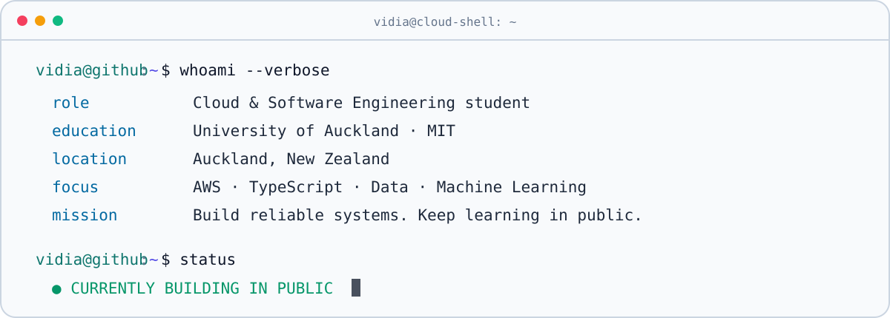

<p align="center">
  
</p>

<p align="center">
  
  
  
</p>

<p align="center">
  
</p>

## `Toolbox`

<p align="center">
  
</p>

## `How I Work`

<table>
  <tr>
    <td width="33%" valign="top">
      <h3>Think in systems</h3>
      <p>I enjoy turning complex ideas into clear structures, reliable flows, and maintainable solutions.</p>
    </td>
    <td width="33%" valign="top">
      <h3>Learn by building</h3>
      <p>I learn best through experimentation, reflection, and shipping something useful.</p>
    </td>
    <td width="33%" valign="top">
      <h3>Clarity over cleverness</h3>
      <p>I value thoughtful communication, simple designs, and steady improvement.</p>
    </td>
  </tr>
</table>

## `Credentials & Current Focus`

```text
credential/  AWS Certified Solutions Architect – Associate  status: earned
engineering/ Full-stack TypeScript       status: shipping
data/        Data & Machine Learning      status: exploring
career/      System Design & Interviews   status: sharpening
```

## `Activity`

<p align="center">
  <picture>
    <source media="(prefers-color-scheme: dark)" srcset="https://raw.githubusercontent.com/77777up/77777up/output/github-contribution-grid-snake-dark.svg" />
    
  </picture>
</p>

<p align="center">
  
</p>
