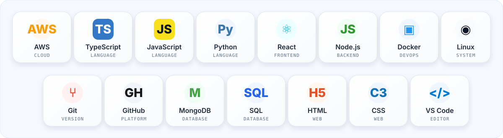

<p align="center">
  
</p>

<p align="center">
  <a href="https://github.com/77777up?tab=repositories"></a>
  <a href="https://github.com/77777up/chromawalk"></a>
  
</p>

<p align="center">
  
</p>

## `Toolbox`

<p align="center">
  
</p>

## `Featured Projects`

<table>
  <tr>
    <td width="50%" valign="top">
      <h3><a href="https://github.com/77777up/chromawalk">ChromaWalk</a></h3>
      <p>A colour-based social mobile application developed as a University of Auckland team project.</p>
      <p><code>TypeScript</code> <code>Mobile</code> <code>Team Project</code></p>
    </td>
    <td width="50%" valign="top">
      <h3><a href="https://github.com/77777up/ml-basics">ML Basics</a></h3>
      <p>Hands-on Machine Learning notebooks and exercises based on Microsoft Learn modules.</p>
      <p><code>Python</code> <code>Jupyter</code> <code>Machine Learning</code></p>
    </td>
  </tr>
</table>

## `Credentials & Current Focus`

```text
credential/  AWS Certified Solutions Architect – Associate  status: earned
engineering/ Full-stack TypeScript       status: shipping
data/        Data & Machine Learning      status: exploring
career/      System Design & Interviews   status: sharpening
```

## `Activity`

<p align="center">
  <picture>
    <source media="(prefers-color-scheme: dark)" srcset="https://raw.githubusercontent.com/77777up/77777up/output/github-contribution-grid-snake-dark.svg" />
    
  </picture>
</p>

<p align="center">
  
</p>
